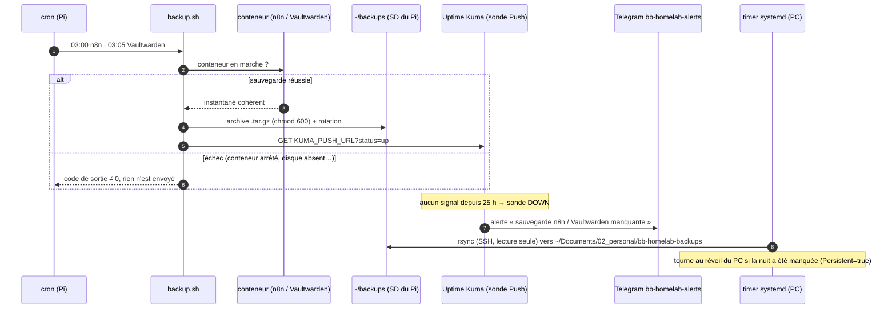

# Diagramme de séquence — sauvegarde nocturne, alerte et copie hors du Pi

> **Fonctionnalité** : issue #133 — alerte en cas d'échec + copie hors du Pi
> **ADR liés** : ADR 0004 (architecture de supervision)
> **Décisions capturées** : signal « réussi » uniquement en cas de succès,
> alerte par absence de signal, copie tirée depuis le PC (le Pi n'a aucun
> accès au PC)

## Contexte

Du 2026-08-24 au 2026-10-22, les sauvegardes n8n et Vaultwarden ont échoué
chaque nuit sans que personne ne le sache, et leurs archives ne vivaient que
sur la carte SD du Pi. Ce diagramme montre une nuit normale et une nuit en
échec avec le nouveau dispositif.

Il ne couvre pas la copie hors site chiffrée (issue #19) ni la sauvegarde de
Caddy et d'Uptime Kuma (issue de suivi).

## Diagramme

## Notes

- Le Pi pousse vers Uptime Kuma, qui tourne sur le même Pi : si le Pi entier
  tombe, la sonde Healthchecks.io existante (ADR 0004) couvre ce cas.
- L'URL de la sonde contient un jeton : elle reste dans un `.env` ignoré par
  git sur le Pi.
