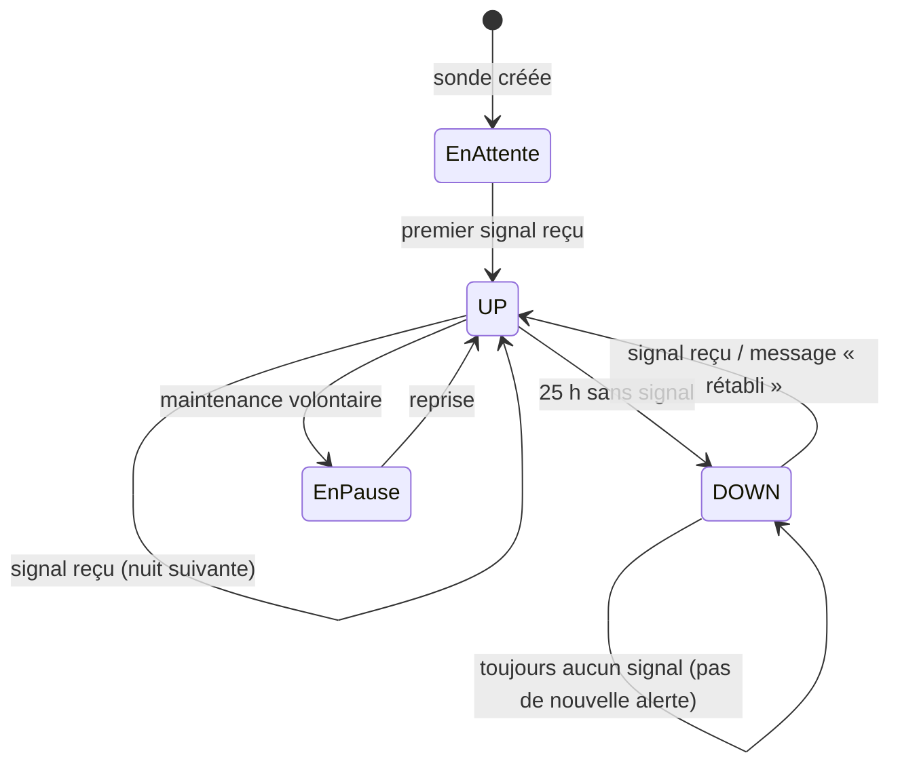

# Diagramme d'état — sonde Push d'une sauvegarde nocturne

> **Fonctionnalité** : issue #133 — alerte en cas d'échec + copie hors du Pi
> **Décisions capturées** : délai de 25 h (une nuit + 1 h de marge), une
> seule alerte par passage à DOWN, un message de retour à la normale

## Contexte

Chaque tâche de sauvegarde (n8n, Vaultwarden) a sa propre sonde Push dans
Uptime Kuma. Ce diagramme décrit les états de cette sonde, du point de vue
de l'alerte reçue par le propriétaire.

## Diagramme

## Notes

- Passage à DOWN : une alerte Telegram, sans répétition.
- Retour à UP : un message « rétabli », pour savoir que la sauvegarde a
  repris sans aller vérifier.
