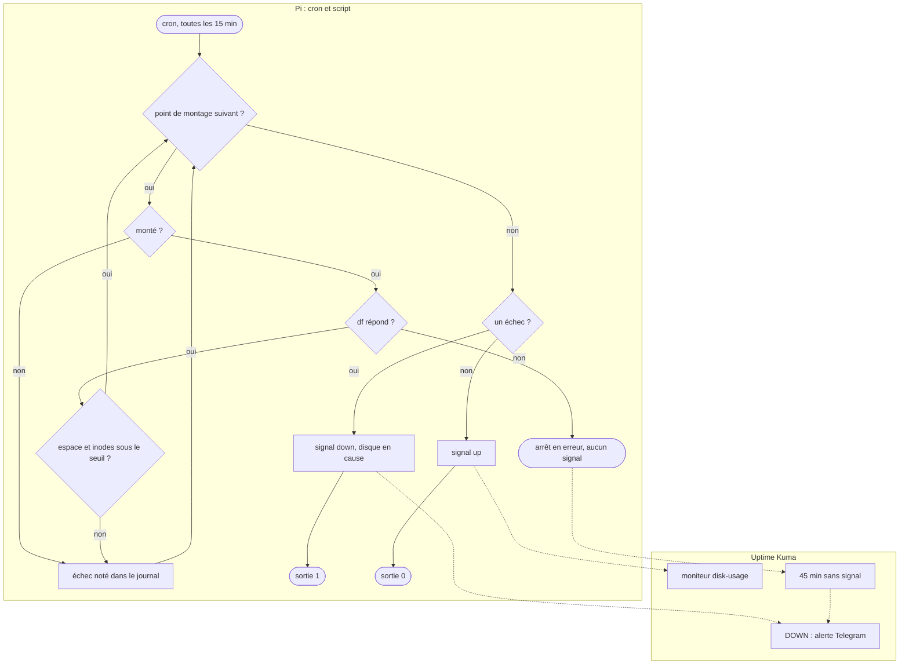

# Diagramme d'activité — vérification du remplissage des disques

> **Fonctionnalité** : issue #202 — alerte avant que la carte SD soit pleine
> **Décisions capturées** : seuil de 80 % (espace et inodes), signal `down`
> qui nomme le disque, absence de signal pour un cron arrêté, disque démonté
> = échec
> **ADR liés** : [0004](../../../decisions/0004-monitoring-architecture.md)
> (un Pi éteint relève du veilleur externe)

## Contexte

La tâche cron lance `storage/scripts/disk-usage-check.sh` toutes les
15 minutes. Uptime Kuma tourne sur le même Pi.

## Diagramme

## Notes

- Retour sous le seuil : le signal `up` reprend, Kuma envoie « rétabli ».
