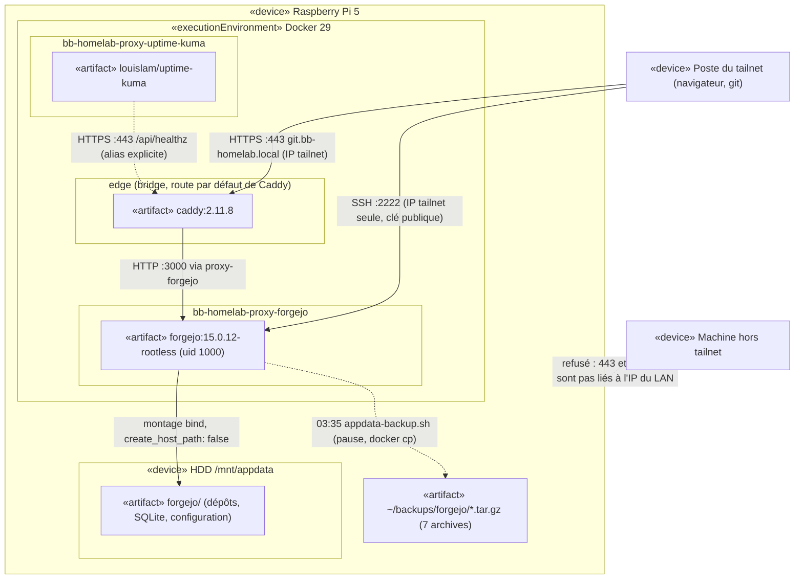

# dep — Forgejo — forge git sur le tailnet (prod)

> **Fonctionnalité** : issue #260 — déployer la forge git Forgejo
> **ADR liés** : ADR 0011 (Forgejo comme forge git), ADR 0009 (un réseau
> proxy par backend), ADR 0007 (liaison des ports publiés)
> **Décisions capturées** : image rootless LTS, base SQLite, web via
> Caddy sur `git.bb-homelab.local`, SSH intégré publié sur l'IP tailnet
> seule (port 2222), données sur `/mnt/appdata/forgejo`

## Contexte

Les projets personnels sont hébergés sur GitHub. Forgejo ajoute une
forge git auto-hébergée sur le Pi, joignable depuis le tailnet seul.

Ce diagramme montre où tourne Forgejo, par quels chemins un client
l'atteint et où vivent ses données. Il ne redessine pas les autres
backends (voir
[`network-isolation/08-deployment.md`](../network-isolation/08-deployment.md))
ni le détail de la sauvegarde (`storage/APPDATA-BACKUP.md`).

## Diagramme

Légende : Caddy est rattaché à `edge`, à `bb-homelab-proxy-forgejo` et
à `bb-homelab-proxy-uptime-kuma` ; Mermaid ne permet pas de dessiner un
nœud dans plusieurs sous-graphes, l'appartenance est donc portée par
les arêtes.

## Notes

- **Deux chemins d'entrée** : le web passe par Caddy (`tls internal`,
  filtre `tailnet_only`, seul `/api/healthz` reste ouvert) ; git en SSH
  arrive directement sur le serveur SSH intégré de Forgejo, sans passer
  par Caddy.
- **Port SSH** : publié sur `100.121.134.61:2222` seulement. Docker
  contourne UFW (ADR 0007) : la liaison à l'IP tailnet est le seul
  filtre, elle ne doit jamais devenir `0.0.0.0`. Le sshd de l'hôte
  (port 22) n'est pas concerné.
- **Authentification SSH** : par clé publique seulement, gérée dans
  Forgejo ; aucun compte système n'est créé sur le Pi.
- **Isolement** : Forgejo ne partage un réseau qu'avec Caddy
  (ADR 0009). Aucun autre backend ne le joint en direct.
- **Durcissement du conteneur** : utilisateur 1000, `cap_drop: [ALL]`,
  `no-new-privileges`, racine en lecture seule, `mem_limit` et
  `memswap_limit` à 512 Mo, `pids_limit` à 256 (même patron que les
  autres services, #256).
- **Données** : tout l'état vit sous `/mnt/appdata/forgejo` (dépôts,
  base SQLite, configuration). `create_host_path: false` empêche un
  démarrage sur la carte SD si le HDD n'est pas monté.
- **Hors périmètre** : pas de runner Forgejo Actions, pas d'inscription
  ouverte, pas d'exposition Internet.
- **Anti-pattern évité** : faire passer git par le sshd de l'hôte
  (compte `git` système et script relais), qui lie la forge à la
  configuration SSH d'administration du Pi.
