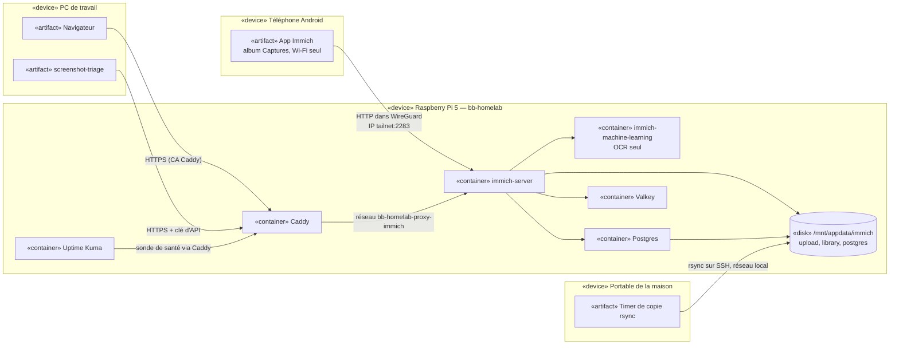

# Diagramme de déploiement — Immich sur le Pi

> **Fonctionnalité** : issue #224 — Immich, source des captures d'écran
> **ADR liés** : ADR 0010, ADR 0007, ADR 0009
> **Décisions capturées** : hôte Pi, stockage `/mnt/appdata/immich`, ML OCR
> seul, téléphone par le tunnel sur le port 2283, PC et screenshot-triage
> par Caddy en HTTPS, copie tirée par le portable de la maison

## Contexte

Ce diagramme montre où tourne chaque élément d'Immich et par quel chemin
chaque client l'atteint. Il ne couvre pas le chemin réseau local du
portable de la maison vers le Pi, encore à décider (ADR 0010,
Consequences).

## Diagramme

## Notes

- Le port 2283 est publié sur `127.0.0.1` et l'IP tailnet seulement
  (ADR 0007) : ni le réseau local ni Internet ne l'atteignent.
- `postgres`, `valkey` et `immich-machine-learning` n'ont aucun port
  publié. Ils partagent un réseau interne avec le serveur seulement.
