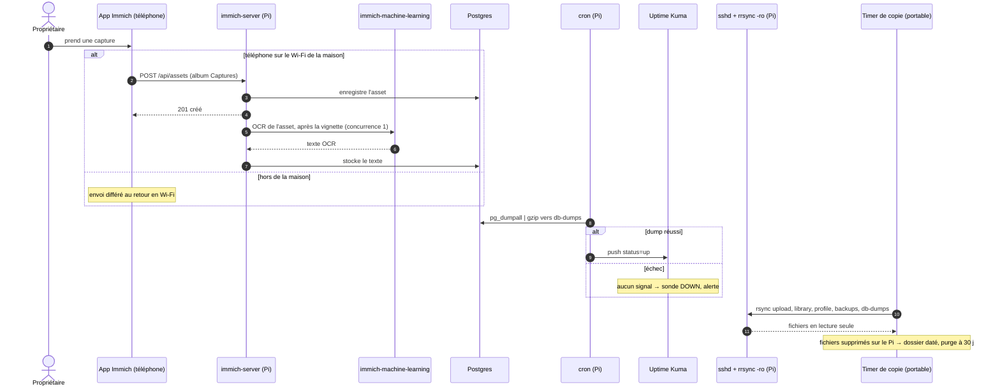

# Diagramme de séquence — envoi d'une capture, OCR et sauvegarde nocturne

> **Fonctionnalité** : issue #224 — Immich, source des captures d'écran
> **ADR liés** : ADR 0010, ADR 0004
> **Décisions capturées** : envoi à la maison en Wi-Fi seulement, OCR dès
> l'envoi, dump Postgres avant la copie des fichiers, signal « réussi »
> seulement en cas de succès, copie tirée par le portable de la maison

## Contexte

Une capture prise dans la journée doit arriver sur le Pi, recevoir son
texte OCR, puis exister en deux exemplaires (Pi et portable de la maison)
avant qu'on la supprime du téléphone. Le tri hebdomadaire par
screenshot-triage vient ensuite ; il est décrit dans son propre dépôt.

## Diagramme

