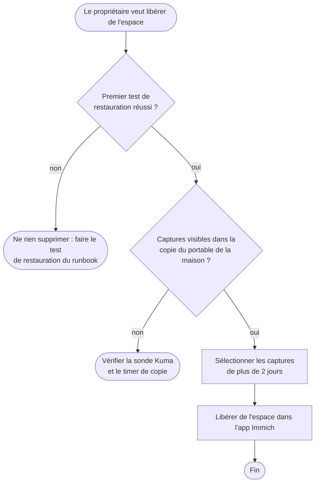

# Diagramme d'activité — libérer de l'espace sur le téléphone

> **Fonctionnalité** : issue #224 — Immich, source des captures d'écran
> **ADR liés** : ADR 0010
> **Décisions capturées** : suppression sur le téléphone seulement après une
> copie vérifiée, captures de plus de 2 jours, premier test de restauration
> réussi

## Contexte

Une fois la pellicule vidée, Immich garde la seule copie vivante des
captures. Cette activité garantit qu'une capture n'est effacée du
téléphone qu'après sa sauvegarde hors du Pi.

## Diagramme

