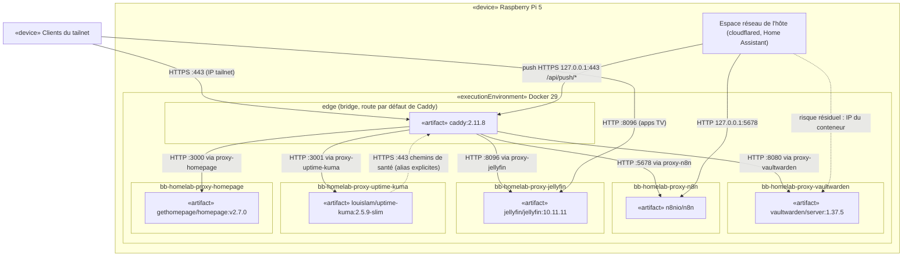

# dep — isolement réseau — un réseau proxy par backend (prod)

> **Fonctionnalité** : issue #200 — isoler Vaultwarden des autres backends
> **ADR liés** : ADR 0009 (un réseau proxy par backend, remplace le
> point 2 de l'ADR 0002), ADR 0007 (liaison des ports publiés)
> **Décisions capturées** : un bridge externe `bb-homelab-proxy-<svc>`
> par backend, rejoint seulement par ce backend et Caddy ; un bridge
> `edge` propre à Caddy porte sa route par défaut ; filtre tailnet sur
> tous les sites Caddy, chemins de santé exemptés ; Uptime Kuma sonde
> les backends via Caddy en HTTPS

## Contexte

Le pentest du 2026-11-04 (carte CONTAINER) a trouvé un bridge plat
unique, `bb-homelab-proxy`, partagé par Caddy et tous les backends. Un
backend compromis atteignait `vaultwarden:8080` en direct, sans passer
par les règles tailnet-only et `/admin` de Caddy, et pouvait usurper
`X-Real-IP`.

Ce diagramme montre les réseaux Docker du Pi après le correctif : parmi
les conteneurs sur bridge, Caddy est le seul présent sur plus d'un
réseau backend. Il ne couvre ni la liaison des ports hôte (ADR 0007) ni
les bridges `default` propres à chaque projet compose.

## Diagramme

Légende : Caddy est rattaché à `edge` et aux cinq réseaux
`bb-homelab-proxy-<svc>` ; Mermaid ne permet pas de dessiner un nœud
dans plusieurs sous-graphes, l'appartenance est donc portée par les
arêtes.

## Notes

- **Invariant d'isolement** : aucun backend sur bridge ne partage un
  réseau avec un autre backend. La carte LATERAL le vérifie **par IP**
  (un test par nom échouerait au DNS même si le routage restait
  ouvert) :
  `docker exec <backend> nc -zv -w3 <IP de Vaultwarden> 8080` échoue
  depuis tout conteneur sauf Caddy.
- **Réseau `edge`** : Caddy y porte sa route par défaut et ses ports
  publiés (`gw_priority`). Sans lui, la passerelle de Caddy serait sur
  le bridge d'un backend, qui pourrait l'empoisonner en ARP et usurper
  une IP tailnet.
- **Filtre tailnet partout** : chaque site Caddy refuse les IP hors
  tailnet, sauf le chemin de santé exact du service (`/alive` pour
  Vaultwarden) et, sur Kuma, `/api/push/*` pour les pushes du Pi. Un backend compromis ne gagne donc
  rien à passer par Caddy, hors ces chemins de santé et le push Kuma
  (jeton requis, #217). `/admin` reste réservé au PC admin.
- **Sondes Kuma via Caddy** : sur le réseau de Kuma, Caddy porte un
  alias par nom de site, listé explicitement (Docker n'accepte pas de
  joker). Kuma ne monte que `root.crt` de la CA interne, jamais le
  dossier PKI qui contient les clés.
- **`X-Real-IP`** : parmi les conteneurs sur bridge, seul Caddy atteint
  Vaultwarden et il écrase l'en-tête ; l'alerte d'échec de connexion
  (#186) voit la vraie IP cliente.
- **Risque résiduel** : les conteneurs en `network_mode: host`
  (cloudflared, Home Assistant) partagent l'espace réseau de l'hôte,
  passerelle de tous les bridges ; ils joignent l'IP du conteneur
  Vaultwarden. Suivi dans #216.
- **Anti-pattern évité** : faire rejoindre à Kuma chaque réseau backend
  pour garder des sondes directes, ce qui referait du conteneur de
  supervision le pivot que le correctif supprime.
